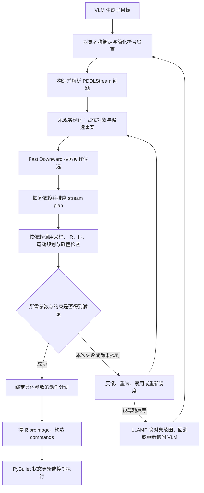

# kitchen-worlds：TAMP 各环节的算法、数值运算与代码入口

本文按「VLM 子目标 → grounding → PDDLStream → 符号搜索 → stream 求值 → 动作执行」解释当前工作区代码。核对日期：2026-10-11。本文是静态源码分析，不是性能实测报告；以当前文件内容（包括已有的本地修改）为准。

阅读约定：

- **源码实现**：可以在本文给出的函数中直接核对。
- **数学等价表达**：解释代码的数学含义，不代表程序一定分配矩阵并按该公式执行。
- **原理示意**：帮助理解外部算法，不据此断言当前二进制采用了某个矩阵分解、精度或求解器。
- 各环节的“入口”通常是函数入口，不一定是可单独运行的脚本。完整实验入口见第 2 节。

> 公式使用纯文本代码块排版，无需 LaTeX/MathJax 插件。`×` 表示乘法，矩阵或向量的下标使用 `_` 表示；具体运算类型以所在段落为准。

## 1. PDDL、Fast Downward、PDDLStream 与 stream 的关系

**PDDL 是描述规划问题的语言；Fast Downward 是离散规划求解器；PDDLStream 是连接离散规划与外部计算的框架。** 因而，不能把 Fast Downward 直接等同于 PDDLStream 名字中的“PDDL”。

PDDL 描述对象、谓词、动作前置条件、动作效果、初始事实和目标。Fast Downward 对编译后的有限符号问题搜索动作序列。它并不直接求机械臂 IK，也不直接对三维场景做碰撞检测。

Stream 是有输入、适用条件、输出和“认证事实”的外部过程接口。实现可以是随机采样、数据库查找、IK、RRT、碰撞测试，甚至确定性函数。**Stream 不是一个名叫 Stream 的统一数值算法。** PDDLStream 的 focused/adaptive 等算法决定何时调用这些过程、如何使用结果重新规划。

例如 [mobile_v5_stream.pddl](pybullet_planning/pddl_domains/mobile_v5_stream.pddl) 中：

```lisp
(:stream sample-pose
  :inputs (?o ?r)
  :domain (and (Stackable ?o ?r) (StaticLink ?r))
  :outputs (?p)
  :certified (and (Pose ?o ?p) (Supported ?o ?p ?r)))
```

含义是：对象 `o` 可以放在静态支撑物 `r` 上时，外部过程生成位姿 `p`，并提供相应事实。Python 实现在 `stream_map['sample-pose']` 中绑定。事实的几何可靠性依赖该过程及启用的检查，并非 PDDL 本身完成物理证明。



图中的连续求解模块存在依赖，不能理解成五个必然并行的独立任务。碰撞检测也嵌在采样、IK 和运动规划内部。失败不等于已经证明不可行；增加复杂度只是若干后续处理之一。

## 2. 全流程入口与调用导航

实验脚本：[run_vlm_paper.py](pybullet_planning/tutorials/run_vlm_paper.py) 的 `main()` / `worker()`。`worker()` 调用 `cogarch_tools.cogarch_run.run_agent()`，配置 `LLAMPAgent`、问题生成器、VLM 后端、对象裁剪策略和求解预算。它是实验批处理入口，参数请以脚本的解析器为准。

主要调用链如下，箭头表示相关调用路径，省略了日志与条件分支：

```text
run_vlm_paper.worker → run_agent
  → LLAMPAgent.policy / replan
  → PDDLStreamAgent.replan
  → stream_agent.solve_pddlstream → solve_one
  → focused.solve_focused（当前是 solve_abstract 的别名）
      ├─ refinement.iterative_plan_streams
      │   → scheduling.plan_streams
      │   → solve_optimistic_sequential → Fast Downward 路径
      └─ stream 求值 / SkeletonQueue / satisfy_optimistic_plan
          → stream_map 中的 Python 过程
  → process_plan → get_primitive_actions → Action.transition 等
```

| 环节 | 脚本与函数入口 |
|---|---|
| VLM 子目标 | [vlm_planning_api.py](pybullet_planning/vlm_tools/vlm_planning_api.py)：`get_subgoals()`、`_query_subgoals()`、`ask()` |
| 对象绑定 | [vlm_utils.py](pybullet_planning/vlm_tools/vlm_utils.py)：`parse_subgoals()` |
| 简化符号 grounding 检查 | [pddlstream_agent.py](pybullet_planning/cogarch_tools/processes/pddlstream_agent.py)：`_check_subgoals_grounding()` |
| 问题构造与求解入口 | [stream_agent.py](pybullet_planning/pybullet_tools/stream_agent.py)：`pddlstream_from_state_goal()`、`solve_one()`、`solve_pddlstream()` |
| 子目标问题更新 | [llamp_agent.py](pybullet_planning/vlm_tools/llamp_agent.py)：`_update_pddlstream_problem()` |
| PDDL / stream 解析 | [algorithm.py](pddlstream/pddlstream/algorithms/algorithm.py)：`parse_problem()`、`parse_stream_pddl()` |
| TAMP 主循环 | [focused.py](pddlstream/pddlstream/algorithms/focused.py)：`solve_abstract()` |
| 乐观实例化 | [refinement.py](pddlstream/pddlstream/algorithms/refinement.py)：`optimistic_process_streams()`、`iterative_plan_streams()` |
| 离散问题编译与搜索 | [plan_streams.py](pddlstream/pddlstream/algorithms/scheduling/plan_streams.py)：`solve_optimistic_sequential()` |
| stream 依赖恢复与排序 | [recover_streams.py](pddlstream/pddlstream/algorithms/scheduling/recover_streams.py)：`extract_stream_plan()`；[reorder.py](pddlstream/pddlstream/algorithms/reorder.py)：`reorder_stream_plan()` |
| 连续过程注册 | [stream_agent.py](pybullet_planning/pybullet_tools/stream_agent.py)：`get_stream_map()`，还要检查机器人自身的 `get_stream_map()` |
| stream 实际求值 | [stream.py](pddlstream/pddlstream/language/stream.py)：`StreamInstance.next_results()` |
| 动作展开与执行 | [actions.py](pybullet_planning/world_builder/actions.py)：`get_primitive_actions()`、`apply_commands()`、`MoveArmAction.transition()` |

本项目的 `meta.py:solve()` 是另一种算法分发入口；上面这条 `solve_one()` 路径直接调用 `solve_focused()`，不必经过 `meta.solve()`。机器人、domain、运行参数不同，会改变实际 stream map 和求解分支。

## 3. VLM 生成子目标

入口：`vlm_planning_api.py:get_subgoals()` → `_query_subgoals()`；动作模式走 `_query_actions()`。

源码中可见的工作包括：收集对象英文名、观察与历史；构造 prompt；调用 `ask()`；将自然语言步骤再翻译成谓词；解析回答；建立子目标树。也可能加载已有回答，因此并非每次都进行模型推理。

本地编排主要是字符串拼接、列表/字典访问、图像准备、文件和 API 操作。**不能把这些 Python 接口当成模型内部的矩阵计算实现。** 若模型在远程服务执行，其模型算力也不属于本机 TAMP 几何求解开销；若本地部署，模型推理需独立测量。本文不推断未检查的模型结构和算子数量。

## 4. 对象绑定与目标 grounding

这里有两个不同步骤：

1. `vlm_utils.py:parse_subgoals()` 把回答中的对象名通过 `world.english_name_to_body` 映射为场景实体，整理谓词和参数。主要是字符串处理、字典查找和条件判断。
2. `pddlstream_agent.py:_check_subgoals_grounding()` 构造简化符号 domain，过滤初始事实，使用空 stream 定义，再调用 `solve_one()` 检查能否得到符号计划。源码还会补充 `handempty` 事实，以偏重语义检查。

第二步本身可能有搜索成本；但它不证明连续几何可行。简化符号计划成立，完整问题仍可能因 IK 或碰撞失败。

此处一般没有大矩阵运算。负担来自对象/事实数量、动作实例化、符号状态搜索，以及 LLAMP 更新问题时的世界对象复制与筛选。

## 5. 构造 PDDLStream 问题

入口：`stream_agent.py:pddlstream_from_state_goal()`；逐子目标更新见 `llamp_agent.py:_update_pddlstream_problem()`。

构造对象是：

```python
PDDLProblem(domain_pddl, constant_map, stream_pddl, stream_map, init, goal)
```

- `domain_pddl`：动作和谓词描述。
- `constant_map`：PDDL 常量到 Python 值的映射。
- `stream_pddl`：外部过程的逻辑声明。
- `stream_map`：声明名称到 Python 函数/生成器的映射。
- `init`、`goal`：当前事实和目标表达式。

主要运算是事实提取、去重/筛选、对象引用映射、列表/集合处理。`_update_pddlstream_problem()` 还复制世界、裁剪参与规划的对象并更新障碍物绑定。裁剪减少后续实例化规模，但可能需要失败后扩大对象范围。

这里的 PDDL 对象可以包装关节向量、位姿、轨迹；符号层主要使用对象身份和事实关系，不会自动对这些值进行矩阵运算。

## 6. 解析 PDDL 与 stream

入口：`algorithm.py:parse_problem()`、`parse_stream_pddl()`；单个 stream 解析见 `language/stream.py:parse_stream()`。

将文本解析为动作、谓词、条件和效果；建立输入/输出参数绑定；将初始事实转换为 evaluations；规范化 domain/goal 并加入计划约束。

计算类型是语法树遍历、符号替换、哈希索引、逻辑表达式转换和一致性检查。此处的“grounding/实例化”是逻辑变量绑定，不是求空间坐标，也不是线性方程组求解。

## 7. 乐观符号规划：先假设存在连续解

入口：`focused.py:solve_abstract()`、`refinement.py:optimistic_process_streams()` / `iterative_plan_streams()`；占位对象生成见 `StreamInstance.next_optimistic()`。

例如当前还不知道有效抓取 `g`、关节配置 `q` 和路径 `t`，先生成代表候选输出的乐观对象，并用 stream 的 certified 模板生成候选事实。这样离散求解器可以先搜索有希望的动作结构，随后才为相关候选调用昂贵几何过程。

主要工作是：事实匹配、变量替换、依赖传播、候选实例加入队列，以及复杂度/effort/代价的标量计算。`instantiation.py:Instantiator` 管理实例与复杂度。

**复杂度阈值限制的是 stream 实例化/求值探索规模，不是浮点精度、矩阵维度或机械臂自由度。** 乐观事实不是已经通过碰撞或 IK 验证的真实结果。

## 8. Fast Downward 搜索动作候选

入口：`scheduling/plan_streams.py:solve_optimistic_sequential()`。

源码先执行 `task_from_domain_problem()`、`instantiate_task()` 和 `sas_from_instantiated()`，将有限候选对象上的问题转换为离散任务。随后按 `forbid` 等参数进入 `solve_from_task()` 或 `diverse_from_task()`；不能把多候选计划模式也简化成单次 `run_search()`。

相关实现：

- [search.py](pddlstream/pddlstream/algorithms/search.py)：`solve_from_task()`。
- [downward.py](pddlstream/pddlstream/algorithms/downward.py)：`SEARCH_OPTIONS`、`run_search()`。
- [eager_search.cc](pddlstream/downward/src/search/search_engines/eager_search.cc)：搜索节点扩展。
- [ff_heuristic.cc](pddlstream/downward/src/search/heuristics/ff_heuristic.cc)：FF 启发式实现。

`solve_one()` 配置的 `ff-astar1` 对应带 FF 启发式、preferred 队列的 eager 搜索配置。优先级可以用 `g + w*h` 理解，当前名称对应 `w=1`；实际配置还包含代价转换与交替队列。因此不要仅凭名称就宣称它具有标准最优 A* 的保证。

典型计算：检查动作前置条件；生成后继状态；累加代价；计算启发式；插入/弹出优先队列；对状态去重。FF 启发式涉及松弛规划结构与代价传播，而非几何求逆。

硬件上主要关注状态数量、内存访问、缓存局部性、哈希和分支。搜索返回的计划可能仍含乐观对象，它是待具体化的候选计划。

## 9. 恢复并排序 stream plan

入口：`plan_streams.py:recover_stream_plan()`、`recover_streams.py:extract_stream_plan()`、`reorder.py:reorder_stream_plan()`。

先从动作所需事实反向追踪“哪个 stream 能产生该事实”，递归恢复依赖。例如先生成抓取和位姿，才能给 IK 提供输入。再在依赖约束允许的顺序中重排，尽量减少失败前的计算浪费。

`reorder.py:compute_expected_cost()` 的源码递推为：

```python
expected_cost = 0.
for result in reversed(stream_plan):
    p_success, overhead = stats_fn(result)
    expected_cost = overhead + p_success * expected_cost
```

对应估算：

```text
E = c₁ + p₁ × c₂ + p₁ × p₂ × c₃ + ...
```

即前面成功才需要支付后面的成本。它是统计估计，不是对相关成功事件的精确概率证明。源码默认依据统计信息选择 `layer` 或 `optimal` 重排；后者使用动态规划，较长 stream plan 可能带来显著组合搜索和内存开销。

运算包括图遍历、拓扑约束、子集状态处理、标量乘加与比较。这里也不是大型矩阵运算。

## 10. 连续参数求解的公共数学基础

Python 中常见的位姿是 `(point, quaternion)`，不是直接存储的 4×4 矩阵。相关函数在 [utils.py](pybullet_planning/pybullet_tools/utils.py)：`multiply()`、`invert()`、`tform_from_pose()`。

### 10.1 位姿组合与点变换

数学等价表达：令 `T_AB` 将 B 坐标变换到 A 坐标，写作：

```text
    ┌ R  t ┐
T = │      │
    └ 0  1 ┘

T_AC = T_AB × T_BC
R_AC = R_AB × R_BC
t_AC = R_AB × t_BC + t_AB

R：3×3 旋转矩阵；t：3×1 平移向量；0：1×3 零向量。
```

对一点则是 `p_A = R_AB p_B + t_AB`。实际 `multiply()` 调用 `p.multiplyTransforms()`，可能直接用四元数实现旋转合成。

若按稠密旋转矩阵计算，3×3 矩阵乘法是 27 次标量乘法、18 次加法；平移更新是 9 次乘法、9 次加法。这只是该数学表达的朴素运算量，不是 PyBullet 的实测指令数，也不包含格式转换。

### 10.2 刚体位姿求逆

```text
         ┌ Rᵀ  −Rᵀ × t ┐
T⁻¹  =   │             │
         └ 0      1    ┘

Rᵀ 表示 R 的转置；T⁻¹ 表示刚体变换 T 的逆。
```

`invert()` 调用 `p.invertTransform()`。旋转矩阵具有正交结构，不能把这里按一般 4×4 高斯消元求逆估算。单位四元数的逆可用共轭表示；非单位四元数不能忽略模长条件。

位姿是刚体变换，不能随意把两个齐次矩阵逐元素相加/相减当作新的合法位姿。代码中更常见的是位置/关节向量加减、旋转合成与相对变换。

### 10.3 FK：正运动学

原理表达为 `T_world,tool(q) = T_world,base × T_1(q_1) × ... × T_n(q_n) × T_tool`。旋转关节的局部变换包含 `sin/cos`，平移关节包含沿轴的线性位移；链式计算包含旋转合成与平移更新。

可直接阅读 IKFast 的 [left_arm_ik.cpp](pybullet_planning/pybullet_tools/ikfast/pr2/left_arm_ik.cpp) 中 `ComputeFk()`。其他状态更新、连杆位姿查询还会进入 PyBullet；并非每次查询都会完整重算一条链，缓存和引擎更新策略需要后端证据。

## 11. 位姿与抓取采样

入口：`general_streams.py:get_stable_list_gen()` / `get_stable_gen()`、`get_contain_list_gen()`、`get_grasp_list_gen()` / `get_grasp_gen()`。

### 11.1 放置位姿

常见路径进入 `utils.py:sample_placement()` → `sample_placement_on_aabb()`，此外还有领域特定采样与已保存结果分支。

源码先随机采样 yaw，更新物体姿态并取包围盒。设支撑物包围盒为 `[l,u]`、旋转后物体包围盒尺寸为 `e`，则采样范围的计算为：

```text
l'_xy = (l + percent × e / 2)_xy
u'_xy = (u − percent × e / 2)_xy

下标 xy 表示只取向量的 x、y 分量。
```

再在范围内采样 x、y，用 `u_z + e_z/2 + epsilon` 构造高度，并修正物体原点与包围盒中心的偏移。一般均匀采样的数学表达是 `x = l + r(u-l)`，`r∈[0,1)`。

运算包括随机数、向量加减、标量乘除、范围比较、旋转变换和碰撞拒绝采样。稳定放置在这里主要由几何规则与检查实现，不能据函数名断言它求解了完整接触力平衡问题。

### 11.2 抓取

`get_grasp_gen()` 可能加载保存的抓取，也可能进入 [grasp_utils.py](pybullet_planning/pybullet_tools/grasp_utils.py) 的 `get_hand_grasps()`；随后调用机器人 `make_grasps()` 并过滤方向等条件。

主要计算是候选位姿生成/读取、坐标系变换、接近位姿偏移、方向判断和夹爪碰撞检查。不能把这个接口一概视为在线神经网络抓取生成或大型连续优化。

## 12. 逆可达性 IR 与底座采样

入口：`mobile_streams.py:get_ik_gen_old()`、`sample_bconf()`、`get_ir_sampler()`。

IR 的目标是为“给定物体位姿和抓取”寻找有希望的底座配置。具体分支包括：

| 分支 | 入口与计算 |
|---|---|
| 均匀采样 | `utils.py:sample_reachable_base()` / `uniform_pose_generator()`：采样半径、方向角、yaw；计算 `x=x_target+r*cos(theta)`、`y=y_target+r*sin(theta)` |
| 逆可达数据库 | `pr2_utils.py:learned_pose_generator()`：加载并打乱相对位姿列表，计算 `T_world,base = T_world,gripper × T_gripper,base`，提取 x、y、yaw |
| 领域保存配置 | `sample_bconf()`：调用 `world.learned_bconf_list_gen`，遍历已有配置，必要时进一步调用 IK |
| 含底座/躯干的 IK | `sample_bconf()`：在相应机器人配置下通过 TRAC-IK 生成整链候选，再检查约束 |

`learned` 并不必然意味着本次调用做神经网络前向推理。上述数据库分支主要是读表、采样、变换和检查。普通采样中的半径均匀也不等同于圆环面积均匀分布。

底座可能是 `(x,y,yaw)`，也可能包含躯干高度等额外自由度，不能统一按 3 维估算。成功的 IR 候选仍需后续精确 IK/路径验证。

## 13. IK 求关节配置，以及抓取接近路径

入口：`mobile_streams.py:get_ik_fn_old()` → `solve_approach_ik()` → `robot.inverse_kinematics()`。该 stream 不一定只返回关节角：例如上述 `mobile_v5_stream.pddl` 的 `inverse-kinematics` 输出是轨迹 `?t`，内部还包括接近运动规划。

`solve_approach_ik()` 计算抓取位姿和接近位姿，求相应配置，再按分支生成运动轨迹。IK 后端选择见 [robots.py](pybullet_planning/robot_builder/robots.py) 的 `run_ik_once()`：有 TRAC-IK 时优先使用，否则尝试已编译的 PR2 IKFast，再回退到 PyBullet 路径。其他机器人覆盖实现或整链分支应单独检查。

### 13.1 IKFast：源码可见的解析运算

入口：[ikfast/pr2/ik.py](pybullet_planning/pybullet_tools/ikfast/pr2/ik.py) → `pr2_inverse_kinematics()` / `get_ik_generator()`；底层是 `left_arm_ik.cpp`、`right_arm_ik.cpp` 的 `ComputeIk()`。

例如左臂源码中有：

```cpp
pp=((px*px)+(py*py)+(pz*pz));
npx=(((px*r00))+((py*r10))+((pz*r20)));
```

分别是平方和、点积。整个求解还包含三角函数、反三角函数、开方、倒数/除法、根与候选解处理，以及奇异情况分支。Python 包装会采样自由参数、筛选关节限位、选择候选，并检查碰撞。

**这里不是通用矩阵求逆算法。** 硬件分析应计入特殊函数、分支、候选数量和依赖链，而不只统计乘加。

### 13.2 TRAC-IK：本仓库可见的是包装层

入口：[tracik.py](pybullet_planning/pybullet_tools/tracik.py) 的 `IKSolver.solve()`。

源码执行世界到基座的位姿变换、构造 4×4 目标矩阵、设置位置/姿态容差，并调用 `self.ik_solver.ik(...)`。构造器配置了 `solve_type='Speed'`、超时和误差参数。

当前包装层不足以证明其内部采用某一种矩阵求逆或分解。若要估算硬件，需要继续核对实际安装的 `tracikpy` / TRAC-IK 本地库及其版本。

为理解“数值 IK 可能涉及什么”，下面仅给出**阻尼最小二乘原理示意，不是对当前后端实现的断言**：

```text
e  = x_target − x(q)
(J × Jᵀ + λ² × I) × y = e    ← 求解关于 y 的线性方程组
Δq = Jᵀ × y
q  ← q + Δq

Jᵀ：雅可比矩阵的转置；λ：阻尼系数；I：单位矩阵。
Δq：关节配置增量；←：将右侧结果赋给左侧变量。
```

位姿误差 `e` 通常使用局部位置/旋转误差表达，不能直接用齐次矩阵逐元素相减代替。对 6 维任务，`J` 可为 `6×n`。示意计算包括 FK、误差、雅可比、小矩阵乘法、对角正则项、线性方程求解和向量更新。即使公式写成逆矩阵，也不意味着实现会显式求逆。

### 13.3 PyBullet 路径

入口：`utils.py:inverse_kinematics()`、`inverse_kinematics_helper()` → `p.calculateInverseKinematics()`。

可见外层迭代调用后端、设置配置、检查末端位姿接近程度和关节限位；默认外层最大迭代数为 200。这个数字不等于后端内部迭代数，也不是实际每次都迭代 200 次。具体数值核需查看实际 PyBullet 后端。

## 14. 运动路径规划：BiRRT / RRT-Connect

入口：`utils.py:plan_joint_motion()`；底座 stream 见 `pr2_streams.py:get_base_motion_gen()`。

`plan_joint_motion()` 创建采样、距离、扩展和碰撞函数；`algorithm is None` 时调用 `birrt()`。实现见 [rrt_connect.py](pybullet_planning/motion/motion_planners/rrt_connect.py) 与 [primitives.py](pybullet_planning/motion/motion_planners/primitives.py)。可选算法、teleport 和直接路径分支会改变工作量。

### 14.1 采样与最近邻

树扩展时：

```python
last = argmin(lambda n: distance_fn(n.config, target), tree)
```

当前这一步扫描树节点。配置维数为 d、树节点数为 N 时，单次距离扫描约为 `O(Nd)`。整个规划成本还依赖扩展次数与碰撞检查，不能仅用这个复杂度代表全部耗时。

`utils.py:get_distance_fn()` 的常见分支：

```python
diff = np.array(difference_fn(q2, q1))
return np.sqrt(np.dot(weights, diff * diff))
```

即 `sqrt(sum_i(w_i * delta_q_i^2))`。连续旋转关节还需周期角差处理。主要是向量减法、乘法、归约求和、平方根和比较。

### 14.2 步长和插值

`get_extend_fn()` 根据 `norm(delta_q / resolutions)` 计算离散步数；`get_refine_fn()` 逐步计算：

```python
positions = (1. / (num_steps - i)) * np.array(difference_fn(q2, q)) + q
```

这是差向量、标量除法、缩放与加法。数学上沿配置空间线段推进；连续旋转关节使用周期差。分辨率越细，生成配置越多，后续碰撞检测次数通常也越多。

### 14.3 两棵树与碰撞验证

`rrt_connect()` 从起点和终点建立两棵树，向采样目标和另一棵树的新节点扩展，连接成功后回溯路径。`birrt()` 包装重启等过程；平滑等后处理也可能触发新路径检查。

RRT 核心不是对整条轨迹进行一次大型矩阵求解。其成本通常来自大量小向量运算、最近邻扫描和几何验证。

## 15. 碰撞与约束检查

入口：`utils.py:get_collision_fn()`、`pairwise_collision()`、`pairwise_link_collision()`、`get_closest_points()`；stream 级测试见 `general_streams.py:get_cfree_pose_pose_test()`、`get_cfree_traj_pose_test()`。

每个待检查配置可能需要：检查关节限位；更新关节和附件位姿；遍历自碰撞连杆对；检查机器人/附件与障碍物组合；调用 `p.getClosestPoints()`。

### 15.1 限位与包围盒

关节限位是逐维 `lower_i <= q_i <= upper_i`。AABB 重叠的数学条件是每轴满足 `max(l_A,l_B) <= min(u_A,u_B)`。这些主要是比较、min/max 与布尔归约。

`get_collision_fn()` 有可选的 Python 层 `use_aabb` 过滤。关闭它不意味着 Bullet 内部完全没有空间加速结构；不能把包装层选项与引擎内部机制混为一谈。

### 15.2 精细几何距离/碰撞

实际几何计算通过 `p.getClosestPoints()` 进入后端。可涉及变换、距离、点积、叉积和几何层次遍历，但具体算法随碰撞形状及后端变化。本文没有从这个接口推断所有模型都采用同一个 GJK、EPA 或网格算法。

估算工作量可写成：

```text
C ≈ N_checked_configurations × mean(N_candidate_pairs) × mean(C_pair)

N_checked_configurations：实际检查的配置数量。
mean(N_candidate_pairs)：每个配置平均检查的候选碰撞对数量。
mean(C_pair)：单对几何检测的平均成本。
```

提前碰撞退出、过滤、缓存和几何复杂度都会改变实际成本。碰撞检测横跨多个环节，统计 IK、RRT 与碰撞的累计时间时必须处理嵌套，避免重复相加。

离散插值点无碰撞也不自动构成连续时间扫掠体无碰撞证明；需要结合分辨率及实际检查方式理解“通过”。

## 16. stream 结果、失败反馈和复杂度增长

入口：`StreamInstance.next_results()`；调度见 [disabled.py](pddlstream/pddlstream/algorithms/disabled.py) 的 `process_stream_plan()`、[skeleton.py](pddlstream/pddlstream/algorithms/skeleton.py) 的 `SkeletonQueue`，以及 `focused.py:satisfy_optimistic_plan()`。

成功结果用具体 Python 值替换乐观输出，并加入 certified facts。后续 stream 使用已绑定的输入。失败或暂时未产生输出时，可能换样本、处理另一组绑定、禁用/重新启用实例，或返回符号搜索。

当前 `focused.py` 有普通求值、SkeletonQueue 和收集多计划等分支。`run_vlm_paper.worker()` 配置多候选计划，不能只看一条 `process_stream_plan()` 路径。

“所有 stream 成功”更准确的含义是：当前候选计划所需要的结果与约束已得到满足，不是全局所有已声明 stream 都必须执行。一次采样失败、超时或预算耗尽不等于数学上证明问题无解。

代码在没有乐观候选等情况下增加 `complexity_limit`，并可能重新启用实例。更外层 `LLAMPAgent.policy()` 还会扩大规划对象范围、回退子目标树，或在配置允许时重新询问 VLM。这是两层不同的反馈循环。

这里的计算主要是映射替换、事实插入、队列操作、计数和预算比较；昂贵之处往往是它触发了多少次重复的 IK、碰撞及符号搜索。

## 17. 生成具体计划、preimage 与 commands

入口：`plan_streams.py:recover_stream_plan()`、`stream_agent.py:solve_pddlstream()` / `post_process()`、`pddlstream_agent.py:process_plan()`、`actions.py:get_primitive_actions()`。

具体计划包含绑定后的抓取、配置、轨迹等对象。`preimage_facts` 是恢复计划时收集的支持事实集合；源码还会加入部分 stream 的条件与认证事实。**preimage 在这里不是图像，也不是矩阵逆或 IK 的另一个名称。** 它不应被一概理解成严格最小的逻辑回归集合。

`solve_pddlstream()` 清理并提取 `evaluations.preimage_facts`；因此 preimage 的计算不是全部等到计划成功后才开始。`post_process()` 或在线 `process_plan()` 再把符号动作展开为底座移动、机械臂轨迹、夹爪开闭、附着/分离等原语。

主要运算是事实追踪/过滤、参数替换、轨迹遍历、列表展开。`get_primitive_actions()` 还可能抽稀路径或在 teleport 模式下只取端点；不要把命令点数直接等同于规划时检查的配置数量。

## 18. PyBullet 执行动作

入口：`actions.py:MoveArmAction.transition()`、`MoveBaseAction`、`apply_commands()`；夹爪等控制另有 `control()` 路径。

当前 `MoveArmAction.transition()` 直接调用 `set_joint_positions()` 更新配置，并可能额外检查碰撞。这种运动学状态回放不等于完整动力学控制仿真。

如果实际走控制器与 `stepSimulation()` 路径，才需要另行分析动力学、接触约束、积分与电机控制开销。不能因为用了 PyBullet，就假设每个 TAMP 规划点都在求质量矩阵、接触力和动力学方程。

运动学执行主要涉及状态赋值、连杆/附件变换、碰撞与渲染。GUI、录制、绘图、日志和等待也可能占用墙钟时间，应与规划算力分开测量。

## 19. 从硬件角度整理：到底是什么运算

| 模块 | 主要算术/数据操作 | 规模特征 | 需要关注的硬件负担 |
|---|---|---|---|
| VLM | 本地仅见请求编排；模型算子在所选后端 | 与模型部署有关 | 推理设备/网络，单独统计 |
| grounding / PDDL 编译 | 字符串、集合、哈希、变量替换 | 随对象、事实、动作实例增长 | 内存、分支、对象分配 |
| Fast Downward | 条件检查、整数/标量代价、启发式、队列 | 随搜索状态增长 | 缓存、内存容量、不规则访存 |
| stream 排序 | 图遍历、拓扑约束、乘加、动态规划 | 可出现子集组合增长 | 内存、控制流 |
| 位姿 / FK | 小尺寸旋转合成、矩阵向量乘加、三角函数 | 单次小，调用多 | 延迟、批处理、状态更新 |
| 放置 / IR / 抓取 | 随机数、读表、变换、限位和碰撞筛选 | 候选数与失败率驱动 | 数据读取、拒绝采样 |
| IKFast | 标量乘加、除法、sqrt、sin/cos、acos/atan2 | 多分支、多候选 | 特殊函数、串行依赖、分支 |
| 数值 IK | 外部后端；可能有 FK/Jacobian/小矩阵求解 | 迭代数与链维数驱动 | 需先确认实际数值核 |
| RRT 最近邻 | 向量差、平方、加权归约、sqrt、argmin | 此处单次约 O(Nd) | 节点访存、批量距离计算 |
| RRT 插值 | 向量加减、缩放、除法 | 分辨率决定配置数 | 本身较简单，放大碰撞调用量 |
| 碰撞 | 几何变换、距离、比较及后端几何运算 | 配置数 × 候选对 × 几何成本 | 几何访存、分支、重复调用 |
| commands / 回放 | 列表展开、赋值、附件变换 | 轨迹点数驱动 | Python/引擎接口、渲染 |

**优先测碰撞、实际 IK 后端、RRT 最近邻，再同时检查符号搜索和 stream 重排是否占主导。** 这是测量顺序建议，不是本场景已经测出的排名。TAMP 不是主要由大型稠密矩阵乘法构成的统一工作负载。

“矩阵除法”也不是上述算法中的统一基本操作：`delta_q / resolutions` 是逐元素除法；标量倒数是另一类运算；`Ax=b` 是线性系统求解；位姿逆又利用了刚体结构。硬件预算应区分这些操作。

## 20. 如何用当前代码验证热点

工作区已有 [tamp_profile.py](pddlstream/pddlstream/tamp_profile.py)，提供 `TAMP_PROFILE=1` 的逐 replan 墙钟统计及可选 `TAMP_CPROFILE=1`。输出默认写到实验目录下的 `tamp_profiles/`，`TAMP_PROFILE_DIR` 可指定父目录。

可在已有实验启动命令前设置环境变量；本文未运行新实验，也未修改现有插桩：

```bash
export TAMP_PROFILE=1
export TAMP_CPROFILE=1
# 随后运行原有实验命令和原有参数
```

现有代码可见 `phase.*`、`solver.*`、`stream.*` 和部分 `kernel.*` 标签，但标签存在不代表所有后端内部计算都已覆盖。应先确认输出是否包含目标计时段，再决定是否补充插桩。

建议逐环节记录：调用次数、成功/失败次数、累计及单次耗时、配置维数、树节点数、碰撞候选对数、几何复杂度、内存峰值。后几项不一定已经由现有工具记录，需要另外采集。

注意三个统计边界：

1. inclusive 时间包含子调用，不能把 IK、运动规划、碰撞等嵌套累计值直接相加。当前工具的 exclusive 仅扣除已插桩的直接子段，不是所有底层计算的严格互斥分类。
2. cProfile 可以定位 Python 与扩展接口耗时，但不能直接告诉你 Bullet/TRAC-IK 内部的浮点指令数量；Fast Downward 子进程内部也需单独分析。
3. 墙钟时间包含等待、I/O 等影响，不等于纯 CPU 运算时间或 FLOPs。若要定芯片规格，还需实际后端、数据精度、吞吐/延迟、工作集与访存数据。

## 21. 推荐阅读顺序

1. `stream_agent.py:get_stream_map()`：明确每个逻辑 stream 绑定了哪个 Python 函数。
2. `mobile_streams.py:solve_approach_ik()`：串起位姿、IK、碰撞与运动规划。
3. `utils.py:get_distance_fn()` / `get_refine_fn()` / `get_collision_fn()`：看实际的小向量计算和检查循环。
4. `robots.py:run_ik_once()`：确认所用 IK 分支，再看 `tracik.py` 或 IKFast 的 `ComputeIk()`。
5. `focused.py:solve_abstract()` 与 `reorder.py`：理解这些昂贵计算为何被选择、排序和重复。
6. `plan_streams.py:solve_optimistic_sequential()` 与 Fast Downward C++：理解离散搜索成本。

函数名是稳定的导航依据；下方附录按本文生成时的实际源码自动记录入口行号，后续代码修改可能使行号变化。

## 附录：当前源码入口行号

以下链接用于本工作区 IDE 跳转；前文相对路径链接便于迁移文档。

| 文件 | 函数入口（点击跳转） |
|---|---|
| `pybullet_planning/tutorials/run_vlm_paper.py` | [worker:36](/data/home/x_long32/workspace/tapeout_2027/kitchen-worlds/pybullet_planning/tutorials/run_vlm_paper.py:36)；[main:135](/data/home/x_long32/workspace/tapeout_2027/kitchen-worlds/pybullet_planning/tutorials/run_vlm_paper.py:135) |
| `pybullet_planning/vlm_tools/vlm_planning_api.py` | [get_subgoals:205](/data/home/x_long32/workspace/tapeout_2027/kitchen-worlds/pybullet_planning/vlm_tools/vlm_planning_api.py:205)；[_query_subgoals:311](/data/home/x_long32/workspace/tapeout_2027/kitchen-worlds/pybullet_planning/vlm_tools/vlm_planning_api.py:311) |
| `pybullet_planning/vlm_tools/vlm_utils.py` | [parse_subgoals:483](/data/home/x_long32/workspace/tapeout_2027/kitchen-worlds/pybullet_planning/vlm_tools/vlm_utils.py:483) |
| `pybullet_planning/vlm_tools/llamp_agent.py` | [policy:326](/data/home/x_long32/workspace/tapeout_2027/kitchen-worlds/pybullet_planning/vlm_tools/llamp_agent.py:326)；[_update_pddlstream_problem:463](/data/home/x_long32/workspace/tapeout_2027/kitchen-worlds/pybullet_planning/vlm_tools/llamp_agent.py:463) |
| `pybullet_planning/cogarch_tools/processes/pddlstream_agent.py` | [_check_subgoals_grounding:600](/data/home/x_long32/workspace/tapeout_2027/kitchen-worlds/pybullet_planning/cogarch_tools/processes/pddlstream_agent.py:600)；[replan:271](/data/home/x_long32/workspace/tapeout_2027/kitchen-worlds/pybullet_planning/cogarch_tools/processes/pddlstream_agent.py:271)；[process_plan:190](/data/home/x_long32/workspace/tapeout_2027/kitchen-worlds/pybullet_planning/cogarch_tools/processes/pddlstream_agent.py:190) |
| `pybullet_planning/pybullet_tools/stream_agent.py` | [get_stream_map:71](/data/home/x_long32/workspace/tapeout_2027/kitchen-worlds/pybullet_planning/pybullet_tools/stream_agent.py:71)；[pddlstream_from_state_goal:510](/data/home/x_long32/workspace/tapeout_2027/kitchen-worlds/pybullet_planning/pybullet_tools/stream_agent.py:510)；[solve_one:611](/data/home/x_long32/workspace/tapeout_2027/kitchen-worlds/pybullet_planning/pybullet_tools/stream_agent.py:611)；[solve_pddlstream:758](/data/home/x_long32/workspace/tapeout_2027/kitchen-worlds/pybullet_planning/pybullet_tools/stream_agent.py:758)；[post_process:956](/data/home/x_long32/workspace/tapeout_2027/kitchen-worlds/pybullet_planning/pybullet_tools/stream_agent.py:956) |
| `pddlstream/pddlstream/algorithms/algorithm.py` | [parse_problem:78](/data/home/x_long32/workspace/tapeout_2027/kitchen-worlds/pddlstream/pddlstream/algorithms/algorithm.py:78) |
| `pddlstream/pddlstream/algorithms/focused.py` | [solve_abstract:152](/data/home/x_long32/workspace/tapeout_2027/kitchen-worlds/pddlstream/pddlstream/algorithms/focused.py:152)；[satisfy_optimistic_plan:106](/data/home/x_long32/workspace/tapeout_2027/kitchen-worlds/pddlstream/pddlstream/algorithms/focused.py:106) |
| `pddlstream/pddlstream/algorithms/refinement.py` | [optimistic_process_streams:56](/data/home/x_long32/workspace/tapeout_2027/kitchen-worlds/pddlstream/pddlstream/algorithms/refinement.py:56)；[iterative_plan_streams:215](/data/home/x_long32/workspace/tapeout_2027/kitchen-worlds/pddlstream/pddlstream/algorithms/refinement.py:215) |
| `pddlstream/pddlstream/algorithms/scheduling/plan_streams.py` | [solve_optimistic_sequential:334](/data/home/x_long32/workspace/tapeout_2027/kitchen-worlds/pddlstream/pddlstream/algorithms/scheduling/plan_streams.py:334)；[recover_stream_plan:159](/data/home/x_long32/workspace/tapeout_2027/kitchen-worlds/pddlstream/pddlstream/algorithms/scheduling/plan_streams.py:159) |
| `pddlstream/pddlstream/algorithms/reorder.py` | [compute_expected_cost:77](/data/home/x_long32/workspace/tapeout_2027/kitchen-worlds/pddlstream/pddlstream/algorithms/reorder.py:77)；[reorder_stream_plan:271](/data/home/x_long32/workspace/tapeout_2027/kitchen-worlds/pddlstream/pddlstream/algorithms/reorder.py:271) |
| `pddlstream/pddlstream/algorithms/disabled.py` | [process_stream_plan:80](/data/home/x_long32/workspace/tapeout_2027/kitchen-worlds/pddlstream/pddlstream/algorithms/disabled.py:80) |
| `pddlstream/pddlstream/language/stream.py` | [next_results:321](/data/home/x_long32/workspace/tapeout_2027/kitchen-worlds/pddlstream/pddlstream/language/stream.py:321)；[next_optimistic:381](/data/home/x_long32/workspace/tapeout_2027/kitchen-worlds/pddlstream/pddlstream/language/stream.py:381) |
| `pybullet_planning/pybullet_tools/general_streams.py` | [get_stable_gen:280](/data/home/x_long32/workspace/tapeout_2027/kitchen-worlds/pybullet_planning/pybullet_tools/general_streams.py:280)；[get_grasp_gen:700](/data/home/x_long32/workspace/tapeout_2027/kitchen-worlds/pybullet_planning/pybullet_tools/general_streams.py:700)；[get_cfree_traj_pose_test:1164](/data/home/x_long32/workspace/tapeout_2027/kitchen-worlds/pybullet_planning/pybullet_tools/general_streams.py:1164) |
| `pybullet_planning/pybullet_tools/mobile_streams.py` | [get_ir_sampler:26](/data/home/x_long32/workspace/tapeout_2027/kitchen-worlds/pybullet_planning/pybullet_tools/mobile_streams.py:26)；[sample_bconf:412](/data/home/x_long32/workspace/tapeout_2027/kitchen-worlds/pybullet_planning/pybullet_tools/mobile_streams.py:412)；[solve_approach_ik:596](/data/home/x_long32/workspace/tapeout_2027/kitchen-worlds/pybullet_planning/pybullet_tools/mobile_streams.py:596) |
| `pybullet_planning/robot_builder/robots.py` | [run_ik_once:701](/data/home/x_long32/workspace/tapeout_2027/kitchen-worlds/pybullet_planning/robot_builder/robots.py:701)；[inverse_kinematics:720](/data/home/x_long32/workspace/tapeout_2027/kitchen-worlds/pybullet_planning/robot_builder/robots.py:720) |
| `pybullet_planning/pybullet_tools/tracik.py` | [solve:124](/data/home/x_long32/workspace/tapeout_2027/kitchen-worlds/pybullet_planning/pybullet_tools/tracik.py:124) |
| `pybullet_planning/pybullet_tools/ikfast/pr2/ik.py` | [pr2_inverse_kinematics:116](/data/home/x_long32/workspace/tapeout_2027/kitchen-worlds/pybullet_planning/pybullet_tools/ikfast/pr2/ik.py:116) |
| `pybullet_planning/pybullet_tools/utils.py` | [invert:1702](/data/home/x_long32/workspace/tapeout_2027/kitchen-worlds/pybullet_planning/pybullet_tools/utils.py:1702)；[multiply:1706](/data/home/x_long32/workspace/tapeout_2027/kitchen-worlds/pybullet_planning/pybullet_tools/utils.py:1706)；[get_distance_fn:3854](/data/home/x_long32/workspace/tapeout_2027/kitchen-worlds/pybullet_planning/pybullet_tools/utils.py:3854)；[get_refine_fn:3876](/data/home/x_long32/workspace/tapeout_2027/kitchen-worlds/pybullet_planning/pybullet_tools/utils.py:3876)；[get_extend_fn:3902](/data/home/x_long32/workspace/tapeout_2027/kitchen-worlds/pybullet_planning/pybullet_tools/utils.py:3902)；[get_collision_fn:4003](/data/home/x_long32/workspace/tapeout_2027/kitchen-worlds/pybullet_planning/pybullet_tools/utils.py:4003)；[plan_joint_motion:4167](/data/home/x_long32/workspace/tapeout_2027/kitchen-worlds/pybullet_planning/pybullet_tools/utils.py:4167)；[sample_placement_on_aabb:4422](/data/home/x_long32/workspace/tapeout_2027/kitchen-worlds/pybullet_planning/pybullet_tools/utils.py:4422)；[inverse_kinematics:4928](/data/home/x_long32/workspace/tapeout_2027/kitchen-worlds/pybullet_planning/pybullet_tools/utils.py:4928)；[get_closest_points:3651](/data/home/x_long32/workspace/tapeout_2027/kitchen-worlds/pybullet_planning/pybullet_tools/utils.py:3651) |
| `pybullet_planning/motion/motion_planners/primitives.py` | [extend_towards:19](/data/home/x_long32/workspace/tapeout_2027/kitchen-worlds/pybullet_planning/motion/motion_planners/primitives.py:19) |
| `pybullet_planning/motion/motion_planners/rrt_connect.py` | [rrt_connect:31](/data/home/x_long32/workspace/tapeout_2027/kitchen-worlds/pybullet_planning/motion/motion_planners/rrt_connect.py:31)；[birrt:76](/data/home/x_long32/workspace/tapeout_2027/kitchen-worlds/pybullet_planning/motion/motion_planners/rrt_connect.py:76) |
| `pybullet_planning/world_builder/actions.py` | [get_primitive_actions:843](/data/home/x_long32/workspace/tapeout_2027/kitchen-worlds/pybullet_planning/world_builder/actions.py:843)；[apply_commands:616](/data/home/x_long32/workspace/tapeout_2027/kitchen-worlds/pybullet_planning/world_builder/actions.py:616) |
| `pddlstream/pddlstream/tamp_profile.py` | [attempt:151](/data/home/x_long32/workspace/tapeout_2027/kitchen-worlds/pddlstream/pddlstream/tamp_profile.py:151) |
